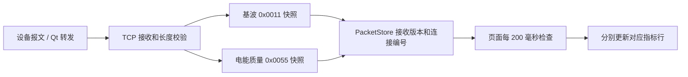

# 实时指标刷新完善说明

## Qt 参考与结论

参考分支：`yuchangdian/New_Jydl_Qt / Unified_structure`，读取时提交为 `b0686db5f1a3cb51ce02ca181b5ba367d1015539`。

- [Qt 实时指标页面](https://github.com/yuchangdian/New_Jydl_Qt/blob/b0686db5f1a3cb51ce02ca181b5ba367d1015539/ui_source/src/quality/PowerQualityRealtimeMonitoringPage.cpp)：连接 `QSerialClient` 的 `update_baseFreq_data` 和 `updateVoltageMonitoringPage` 两个信号。基波报文更新三相频率、电压相量、保护电流相量；电能质量报文更新偏差、分相合格率、序分量、不平衡度和长短闪变。
- [Qt 串口解包及转发](https://github.com/yuchangdian/New_Jydl_Qt/blob/b0686db5f1a3cb51ce02ca181b5ba367d1015539/core_source/client/qserialclient.cpp)：检查完整包长度后解包，每类遥测对象每收到 3 个包向 Qt UI 发一次信号，但每个有效包仍通过 `sendTcpData` 转发。因此 ArkTS 端应读取 TCP 收到的新快照，而不是等待 IPC 订阅响应。
- [Qt 报文定义](https://github.com/yuchangdian/New_Jydl_Qt/blob/b0686db5f1a3cb51ce02ca181b5ba367d1015539/core_source/common/IEC104.h)与 [Qt 电能质量字段](https://github.com/yuchangdian/New_Jydl_Qt/blob/b0686db5f1a3cb51ce02ca181b5ba367d1015539/core_source/common/powerquality.h)：公共地址 `0x1311`，基波对象 `0x0011`，电能质量对象 `0x0055`。

本项目原页面通过 `/api/yc/sub` 串行等待两组 IPC 响应，与当前 TCP 数据链路分离；同时 `PacketStore` 尚未支持电能质量对象，无法直接取得完整指标及接收版本。这两处均已接通。

## 当前数据链路



### 原生层

- `codec.h` 复用已有 `PowerQualityIndicator_struct` 实例化电能质量包类型，静态检查完整包为 **441 字节**、指标起始偏移为 **13**。
- `power_quality_fields.inc` 为 107 个指标和 6 个时间字段建立描述，偏移通过 `offsetof` 计算；指标名称保持 `PowerQuality.字段名`。
- `codec.cpp` 支持 `0x0055` 的查询白名单、严格解包、接收版本及连接编号，复用已有 NAPI 接口，无需新增桥接函数。
- `tcp_client.cpp` 保留原有电能质量缓存更新，并将完整报文同步到 `PacketStore`。

Qt 头文件中的 `Package_PowerQuality_DataLenth = 417` 与实际结构不一致。本次使用真实结构大小：6 字节公共头 + 7 字节时间 + 107 × 4 字节指标 = 441 字节，长度字段为 435。错误长度报文不会覆盖已有有效快照。

### 页面层

`PowerQualityRealtimeMonitoringPage.ets` 改为使用 `Jybsmr131Protocol.telemetry`：

- 进入页面立即读取，两组快照每 200 毫秒各检查一次。仅接收新的 `revision`，重复读取同一缓存不会重建行，也不会重置停更计时。
- 基波和电能质量独立更新。一组未收到或读取异常时，另一组仍可刷新。
- Qt 的 TCP 转发是连续报文流；本项目用 200 毫秒轮询限制 UI 更新频率，不复制串口侧的“每 3 包”计数，避免再次叠加节流。
- 每 2 秒检查一次是否需要补查，仅对缺失或至少 2 秒未收到新版本的组发送查询；发送返回值仅表示请求发送结果，页面值以有效回包为准。
- 某组超过 10 秒未观察到新版本时显示停更提示，并保留该连接最近的有效值；缺失值显示 `--`。
- 连接编号变化时清空两组旧显示，拒绝较旧连接的数据，防止跨连接拼接。
- `broadband.ets` 向子组件传递页面可见状态，隐藏、退出或切换菜单销毁组件后停止定时器，重新显示时恢复。

14 行布局与精度保持原样：普通指标四位小数，相角三位；电流使用 `IA/IB/IC` 保护电流，零序使用 `Uo/Io`，分相合格率分别取 A/B/C 字段，不用总合格率代替。

停更计时从当前组件首次观察到该接收版本开始；重新创建组件时，会先展示当前连接已有的缓存。设备真实采集时间并非本次停更计时依据。

## 验证

- C++ 协议测试通过：441 字节包解析、典型字段的独立字节偏移、载荷末尾字段、合法零值、长度不符保留缓存、查询地址、接收版本递增、重连清空和原有协议回归。
- 页面数据及生命周期测试 15 项通过；与首页、协议封装、波形回归合计 31 项通过。
- OpenHarmony API 18、`default` 产品 debug HAP 编译和签名成功：`BUILD SUCCESSFUL in 39 s 227 ms`，日志为 `md/2026-10-15_实时指标构建.log`。
- 实际 `.preview` 预览构建通过：`BUILD SUCCESSFUL in 34 s 504 ms`，日志为 `md/2026-10-15_实时指标预览构建.log`。成功后已停止本次命令行验证的监听进程。
- 构建仍有项目其他页面已有 API 弃用和组件导出警告。
- 本次未部署到设备，实际 TCP 连续回包、设备侧查询响应及最终视觉效果仍需设备联调。

测试命令：

```powershell
./tests/run-jybsmr131-tests.ps1
$env:REALTIME_TYPESCRIPT_PATH = 'C:/Program Files/Huawei/DevEco Studio/tools/hvigor/hvigor/node_modules/typescript'
$env:JYBSMR131_TYPESCRIPT_PATH = $env:REALTIME_TYPESCRIPT_PATH
$env:WAVEFORM_TYPESCRIPT_PATH = $env:REALTIME_TYPESCRIPT_PATH
& 'C:/Program Files/Huawei/DevEco Studio/tools/node/node.exe' --test tests/realtime-monitoring.test.cjs tests/jybsmr131-arkts.test.cjs tests/waveform-data.test.cjs
```
