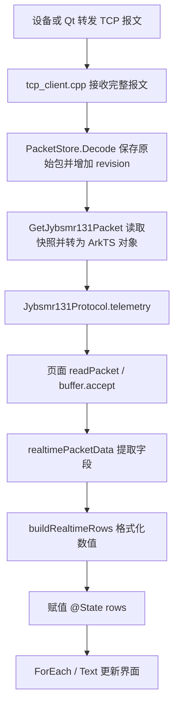

# 实时指标：底层数据到界面刷新流程

## 核心入口

页面真正读取底层数据的位置是 `PowerQualityRealtimeMonitoringPage.ets:344`：

```typescript
return this.buffer.accept(Jybsmr131Protocol.telemetry(address), isBase, now);
```

其中 `Jybsmr131Protocol.telemetry(address)` 读取 C++ 当前缓存，`buffer.accept(...)` 检查新旧版本并组织显示数据。页面通过 NAPI 调用编译到 `libentry.so` 的 C++ 函数。

## 流程图



## 1. TCP 接收并缓存

TCP 客户端由 `EntryAbility.ets` 管理启动，页面使用这个已有连接。

`tcp_client.cpp` 检查公共地址、对象地址、报文长度，完整包交给 `jybsmr131::PacketStore::Instance().Decode(...)`。电能质量包会同时更新已有 `Package_PowerQuality` 全局缓存；本实时指标页面读取的是 `PacketStore` 快照。

`codec.cpp:126` 的 `PacketStore::Decode` 校验包长并加锁保存完整原始字节：

```cpp
frames_[Key(common, object)] = std::vector<std::uint8_t>(frame, frame + length);
revisions_[Key(common, object)] = ++receiveRevision_;
```

每个对象保存最近一包。收到有效新包才更新接收版本；页面反复读取缓存不会增加版本。读取时由 `PacketStore::Get` 根据字段偏移和类型将原始字节转换成数值字段。

## 2. NAPI 将 C++ 快照转换成 ArkTS 对象

`napi_init.cpp:162` 将 ArkTS 方法名 `getJybsmr131Packet` 绑定到 C++ 函数 `GetJybsmr131Packet`。类型声明在 `types/libentry/Index.d.ts`，实际执行逻辑在 `jybsmr131_napi.cpp:74`。

`GetJybsmr131Packet` 调用 `PacketStore::Get(common, object)`，通过 `napi_create_object`、`napi_set_named_property` 和数组接口返回：

```typescript
{
  ready: true,
  revision: 12,
  sessionId: 3,
  commonAddress: 0x1311,
  objectAddress: 0x0011,
  payloadLength: 151,
  fields: [
    { name: 'Ua_Frequency', values: [50] },
    { name: 'Ua_RMS', values: [230] }
  ]
}
```

这是示意快照。`ready` 表示缓存有有效包，`revision` 表示接收版本，`sessionId` 区分连接。快照是数据副本，页面不持有 C++ 原始指针。

## 3. ArkTS 封装调用底层

`protocol/Jybsmr131.ets:1` 导入 `libentry.so`，第 89 行的封装是：

```typescript
static telemetry(address: Jybsmr131TelemetryAddress): Jybsmr131PacketValue {
  return nativeProtocol.getJybsmr131Packet(Jybsmr131CommonAddress.RemoteMetry, address);
}
```

公共地址固定为 `0x1311`，页面分别读取 `BaseValue = 0x0011` 和 `PowerQuality = 0x0055`。这次调用同步读取已有缓存，不等待设备回包。

## 4. 页面启动轮询

`aboutToAppear` → `onPageActiveChanged` → `startPolling`。`startPolling` 先立即执行一次 `pollData`，再每 200 毫秒执行一次。

`pollData` 分别调用 `readPacket(true, now)` 和 `readPacket(false, now)`。前者读取基波，后者读取电能质量，单组异常不会阻塞另一组。

## 5. 把快照转换成可显示的行

`RealtimeMonitoringBuffer.accept` 验证地址、连接编号、就绪状态和接收版本。

- 接收版本没有变化，保留显示，不重新生成行。
- 收到新版本，更新对应组的数据。
- 连接编号变大，清空旧连接的两组数据，拒绝旧连接快照。

`realtimePacketData` 按字段名提取数值。例如基波取 `Ua_Frequency`，电能质量取 `PowerQuality.FreqDeviation_A`。

`buildRealtimeRows` 将这些数值转换为 14 行显示数据。例如 `Ua_Frequency = 50` 转为频率行 A 相单元格的 `50.0000Hz`；有效值四位小数，相角三位小数，缺失值为 `--`。

## 6. 触发界面刷新

页面第 301 行声明：

```typescript
@State private rows: RealtimeMetricRow[] = buildRealtimeRows({}, {});
```

第 367 行是刷新界面的关键赋值：

```typescript
if (baseChanged || qualityChanged) this.rows = this.buffer.rows;
```

`buffer.rows` 是普通缓存；给页面的 `@State rows` 赋值后，ArkUI 会检查依赖该状态的界面。第 444 行的 `ForEach(this.rows, ...)` 生成各行，`metricCell` 内的 `Text(cell.value)` 显示新的文字。列表 key 包含行编号及单元格文字，数值变化时相应行会更新。

## 补充：补查、停更和退出

- 200 毫秒是检查 C++ 缓存的周期，不代表设备采样或网络发送周期。
- 每 2 秒检查是否需要补查；仅对缺失或至少 2 秒未观察到新版本的组调用 `requestTelemetry`。底层构造查询并调用 `TcpClient::Send`；实际显示仍等待有效回包进入缓存。
- 某组超过 10 秒未观察到新版本，显示停更提示并保留该连接已有值。首次进入组件读取旧缓存时，计时从组件观察到该版本开始。
- `broadband.ets` 在 `onPageShow/onPageHide` 更新传给子组件的 `pageActive`，页面隐藏或组件销毁时清理定时器；底层连接仍由 Ability 生命周期管理。

本次仅核对和解释现有实现，未修改业务代码。
